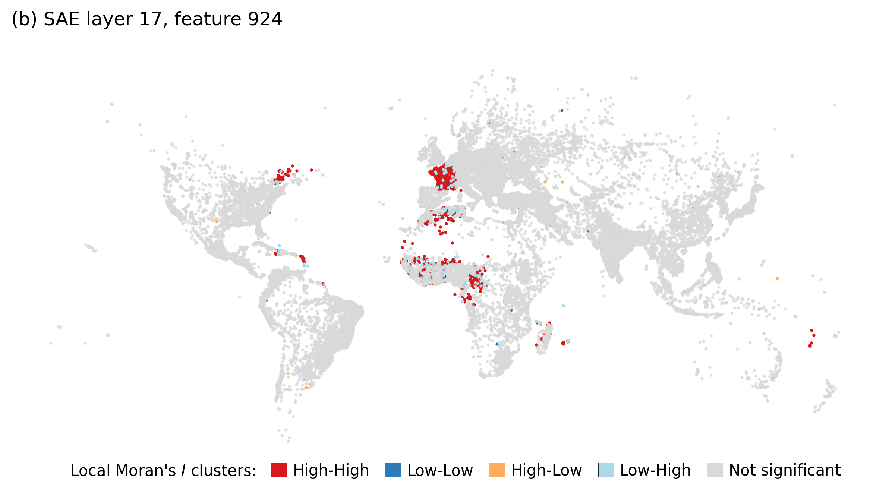
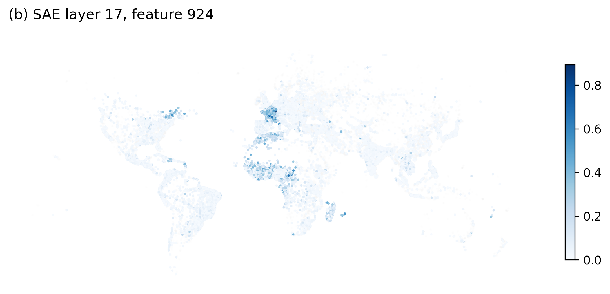

# sae-geographic-orthographic-confound

Full code will be released soon.

## Creating prompt from GeoNames and extracting model's activations
+ Download and extract GeoNames data : 
```
wget -nc https://download.geonames.org/export/dump/allCountries.zip
python -c "import zipfile; zipfile.ZipFile('allCountries.zip').extractall('.')"
```
+ Run the cities (feature class P) extraction for population threshold (`min_pop`)
```
python create_prompts.py 
    --file allCountries.txt
    --min_pop 10000
    --output_path prompts.pkl
```
+ Extract activations from `HuggingFaceTB/SmolLM3-3B` Hugging face model for `layers`. Set `col_name` argument to `name` or `ascii` for corruption.
```
python extract_activations.py 
    --input_path prompts.pkl
    --layers 10,17,31
    --output_path ./
    --col_name [name, asciiname]
```

## Training, evaluating TopK Sparse Autoencoders
+ Train TopK SAE, set k with `top_k` and d_sae with `hidden_dim` (d_sae = d_in * `hidden_dim`) 
```
python topk_sae.py
    --intput_path mlp_act_l17.pkl
    --hidden_dim 8
    --top_k 256
    --epochs 500
```
+ Evaluation recap. To save feature density histogram, set `plot_feat` argument to `True`
```
python eval_sae.py
    --model_path topk_256_sae_l17_dim8.pt
    --df_path mlp_act_l17.pkl
    --k 256
    --N 8
    --plot_feat True
```

## Ploting feature maps
```
python generate_maps.py
    --model_path topk_256_sae_l17_dim8.pt
    --df_path mlp_act_l17.pkl
    --feature_id 924
```



## Additionnal experience : predictions on cities n-grams

```
python geonames_cities.py
```